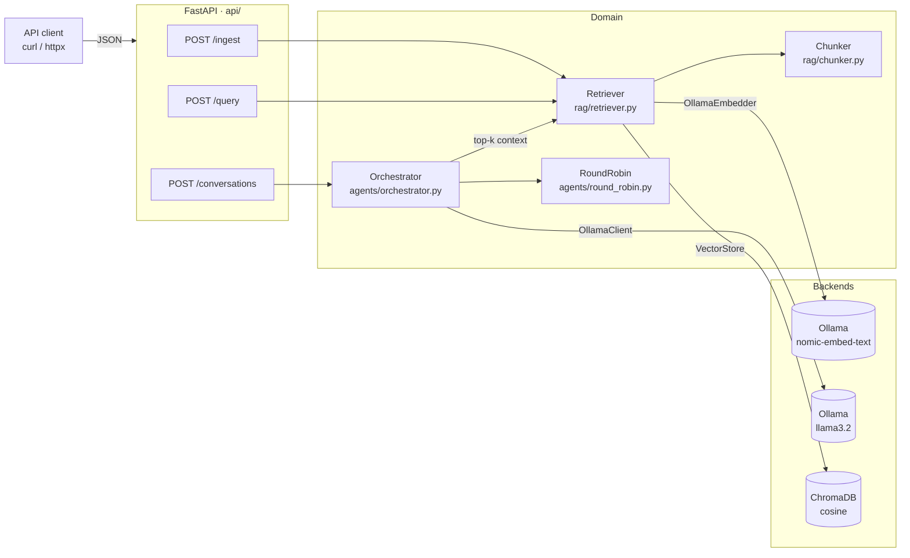

# Enterprise AI Orchestrator

> A local-first GenAI service: Retrieval-Augmented Generation on ChromaDB and round-robin
> multi-agent conversations on Ollama, behind a validated FastAPI API.
> Built test-first and shipped as a multi-stage Docker image.

🇮🇹 [Leggi in italiano](README_IT.md) · 🗺️ [Interactive data-flow map](docs/data-flow/data-flow.html)


---

## Table of contents

- [Overview](#overview)
- [Architecture](#architecture)
- [Design decisions](#design-decisions)
- [Repository layout](#repository-layout)
- [Getting started](#getting-started)
- [Testing](#testing)
- [Running with Docker](#running-with-docker)
- [API reference and examples](#api-reference-and-examples)
- [Configuration](#configuration)
- [Known limitations and roadmap](#known-limitations-and-roadmap)

---

## Overview

The Enterprise AI Orchestrator exposes three capabilities over HTTP:

| Capability | Endpoint | What it does |
|---|---|---|
| **Knowledge ingestion** | `POST /ingest` | Splits a document into overlapping chunks, embeds them with Ollama and stores them in ChromaDB |
| **Hybrid search** | `POST /query` | Ranks chunks with both vector similarity (ChromaDB) and BM25 keyword matching, fused with Reciprocal Rank Fusion |
| **Multi-agent reasoning** | `POST /conversations` | Runs several LLM agents in strict round-robin order on a shared task, optionally grounding each turn with RAG context |

### Goals

- **Run fully local.** Models are served by Ollama, so no data leaves the host and there is no per-token cost.
- **Validate every boundary.** Pydantic v2 models are strict, frozen and reject unknown fields. HTTP payloads, LLM replies, embeddings and vector-store results are all validated.
- **Be testable without a GPU or a model.** The LLM and the embedder sit behind small `Protocol`s, so the whole unit suite runs in seconds with deterministic fakes. Tests against a real Ollama server are a separate, opt-in layer.
- **Ship as a reproducible artifact.** A multi-stage, non-root Docker image with a health check, plus a Compose stack that provisions the models on first start.
- **Development discipline.** Every module was built with TDD: a failing test first, then the implementation.

---

## Architecture



For a richer, interactive version with per-flow explanations, open the
**[data-flow map](docs/data-flow/data-flow.html)** in a browser (light/dark theme, SVG/PNG export).

### Components

| Module | Key types | Responsibility |
|---|---|---|
| `config.py` | `Settings` | Typed configuration from env vars (`OLLAMA_HOST` validated as `HttpUrl`) |
| `api/app.py` | `create_app()` | App factory; maps `ConnectionError` to **503** |
| `api/routes.py` | `/health`, `/ingest`, `/query`, `/conversations` | Thin HTTP layer, no business logic |
| `api/schemas.py` | `QueryRequest`, `ConversationRequest`, … | Request/response contracts with limits (`k ≤ 50`, `max_turns ≤ 20`, unique agent names) |
| `api/dependencies.py` | `get_llm`, `get_retriever`, `get_settings` | Lazily built singletons; replaced in tests via `dependency_overrides` |
| `agents/schemas.py` | `Message`, `AgentSpec`, `Turn`, `Conversation` | Conversation domain model |
| `agents/round_robin.py` | `RoundRobin` | Pure scheduler: fixed cyclic order, rejects empty or duplicate rosters |
| `agents/orchestrator.py` | `Orchestrator` | Turn loop: picks the agent, builds its prompt, injects RAG context, calls the LLM, stops on `max_turns` or `stop_token` |
| `models/llm.py` | `LLMClient` (Protocol), `OllamaClient` | `generate(list[Message], response_format=None) -> Message`; with a Pydantic model, the reply is JSON valid against it |
| `models/embeddings.py` | `Embedder` (Protocol), `OllamaEmbedder`, `Embedding` | Text to a fixed-dimension, finite vector (dimension checked by Pydantic) |
| `rag/schemas.py` | `Document`, `Chunk`, `RetrievalResult` | RAG domain model; score constrained to `[0, 1]` |
| `rag/chunker.py` | `Chunker` | Character windows with overlap; validated `overlap < size` |
| `rag/store.py` | `VectorStore` | ChromaDB wrapper (ephemeral or persistent), cosine space, idempotent upsert, `all_chunks()` for the BM25 index |
| `rag/retriever.py` | `Retriever` | `ingest(Document)` and hybrid `retrieve(query, k)` (vector + BM25, RRF) |

### How a conversation works

1. `RoundRobin` selects the next agent. Rotation restarts on every run, so results are reproducible.
2. If RAG is enabled, the `Retriever` searches with the task on turn 1 and with the latest reply afterwards, so context follows the discussion.
3. The speaking agent receives:
   - its own system prompt, plus a numbered `Relevant context` section;
   - the task;
   - its own previous turns as `assistant` messages;
   - other agents' turns as `user` messages prefixed with `[agent-name]`.
4. The reply is validated as a `Message` and appended as a `Turn`.
5. The loop ends at `max_turns` or as soon as a reply contains `stop_token`. `stop_reason` records which one happened.

---

## Design decisions

| Decision | Why |
|---|---|
| **`Protocol`s for `LLMClient` and `Embedder`** | The domain never imports a vendor SDK type. Swapping Ollama for another provider is a new class, not a refactor. Fakes need no mocking library. |
| **Strict, frozen, `extra="forbid"` Pydantic models** | Typos in payloads fail loudly with a 422, and objects cannot be mutated after validation. |
| **LLM output is re-validated** | An empty reply or an unexpected role from the model raises a `ValidationError` instead of silently corrupting the conversation. |
| **Safe re-ingest** | New chunks are embedded and written first (upsert by chunk id); only then are the old version's surplus chunks deleted. A failing embedder or a rejected write leaves the previous version intact, and no stale chunks survive a shorter re-ingest. |
| **Bounded work per request** | `Document` caps text at 50,000 characters, the id at 256, metadata at 16 entries with keys ≤ 64 and string values ≤ 256 characters. Oversized payloads get a 422 before any embedding. Ollama clients use a 60 s timeout, so a hung backend cannot hold a worker thread forever. |
| **Hybrid retrieval with RRF** | Embeddings miss exact identifiers (error codes, SKUs) that BM25 catches, and vice versa. Each search contributes its top `4·k`; a chunk's score is `Σ 1/(60 + rank)` over both rankings, so it needs no score normalisation across methods. A chunk ranked first by both scores `2/61 ≈ 0.033`. |
| **Structured outputs** | `generate(..., response_format=Model)` sends the model's JSON Schema to Ollama (`format=`) and validates the reply against it, because the schema only guides sampling. |
| **Structured logging** | Loguru writes one JSON object per line to stderr. Each conversation runs inside `logger.contextualize(conversation_id=...)`, so retrieval and LLM logs from that run share the id. Task and reply text are never logged. |
| **503 on backend outage** | If Ollama is down, the client gets a retryable *Service Unavailable*, not an opaque 500. |
| **Hard limits on cost drivers** | `max_turns ≤ 20` (each turn is an LLM call) and `k ≤ 50` are enforced at the API boundary. |
| **Lazy dependency singletons** | Importing the app opens no connection and creates no directory, which keeps tests and tooling side-effect free. |
| **CPU-only PyTorch wheels** | The PyTorch CPU index avoids pulling about 2 GB of CUDA libraries into the image. |

---

## Repository layout

```text
.
├── src/orchestrator/
│   ├── config.py
│   ├── api/          # app factory, routes, request/response schemas, DI
│   ├── agents/       # Message/AgentSpec/Turn/Conversation, RoundRobin, Orchestrator
│   ├── models/       # LLMClient + OllamaClient, Embedder + OllamaEmbedder
│   └── rag/          # Document/Chunk/RetrievalResult, Chunker, VectorStore, Retriever
├── tests/
│   ├── fakes.py      # ScriptedLLM, FakeRetriever, KeywordEmbedder (deterministic doubles)
│   ├── conftest.py   # shared fixtures: embedder, in-memory store, llm
│   ├── api/  agents/  models/  rag/
│   └── models/test_ollama_integration.py   # @pytest.mark.integration
├── docs/data-flow/   # interactive data-flow map (HTML) + its source
├── Dockerfile        # multi-stage, non-root, HEALTHCHECK
├── docker-compose.yml
├── Makefile
├── requirements.txt / requirements-dev.txt
└── pyproject.toml    # pytest config and markers
```

---

## Getting started

### Prerequisites

- Python **3.12**
- [Ollama](https://ollama.com) running locally (only for real inference and integration tests)
- Docker with Compose v2 (optional)

### Local install

```bash
python -m venv .venv
# Windows: .venv\Scripts\activate    macOS/Linux: source .venv/bin/activate
pip install -r requirements.txt -r requirements-dev.txt
```

### Pull the models

```bash
ollama pull llama3.2
ollama pull nomic-embed-text
```

### Run the API

```bash
make run
# or, without make:
python -m uvicorn orchestrator.api.app:app --app-dir src --reload
```

The interactive OpenAPI docs are available at <http://localhost:8000/docs>.

> **Windows note:** `make` is not installed by default (`choco install make`). Every target in the
> `Makefile` is a single command you can also run by hand.

---

## Testing

The suite has two layers, separated by a pytest marker registered in `pyproject.toml` (`--strict-markers` is on).

| Layer | Command | Needs | Speed |
|---|---|---|---|
| Unit and API | `pytest -m "not integration"` | nothing external | about 1 to 5 s |
| Integration | `pytest -m integration` | Ollama with `llama3.2` and `nomic-embed-text` | tens of seconds |
| Everything | `pytest` (or `make test`) | — | — |

- Unit tests use deterministic doubles from `tests/fakes.py` and an **in-memory ChromaDB** (`EphemeralClient`, one uniquely named collection per test).
- API tests drive the real FastAPI app through `TestClient`, swapping only the LLM and the retriever via `app.dependency_overrides`.
- Integration tests **skip themselves** with an explanatory reason when Ollama is unreachable or a model has not been pulled, so CI without a model server stays green.

```bash
pytest -m integration -rs   # -rs prints skip reasons
```

---

## Running with Docker

### Full stack (recommended)

```bash
make docker-up      # docker compose up -d --build
make docker-down    # docker compose down
```

| Service | Image | Role |
|---|---|---|
| `ollama` | `ollama/ollama` | Model server, health-checked with `ollama list`; models persisted in the `ollama-models` volume |
| `ollama-init` | `ollama/ollama` | One-shot job: pulls `${MODEL_NAME:-llama3.2}` and `nomic-embed-text`, then exits |
| `orchestrator` | built from `Dockerfile` | The API on port **8000**; starts only after `ollama-init` succeeds; ChromaDB persisted in the `chroma-data` volume at `/data/chroma` |

The first start downloads the models (about 2.3 GB) into the volume. Later starts reuse them.
To use an NVIDIA GPU, uncomment the `deploy` block of the `ollama` service (requires `nvidia-container-toolkit`).

### Image only

```bash
make docker-build   # docker build -t enterprise-ai-orchestrator .
make docker-run     # docker run --rm -p 8000:8000 enterprise-ai-orchestrator
```

The image is built in two stages:

- **Builder:** a virtualenv with the dependencies installed.
- **Runtime:** `python:3.12-slim` with only the virtualenv and `src/`. It runs as user `app` (uid 1000) and has a `HEALTHCHECK` on `/health` written with the standard library only.

---

## API reference and examples

The responses below were captured from a local run against Ollama (`llama3.2`, `nomic-embed-text`).

### `GET /health`

```bash
curl http://localhost:8000/health
```
```json
{"status": "ok", "version": "0.1.0"}
```

### `POST /ingest` → `201 Created`

```bash
curl -X POST http://localhost:8000/ingest \
  -H "Content-Type: application/json" \
  -d '{
        "id": "caching-guide",
        "text": "Redis supports per-key TTL expiration. An LRU policy evicts the least recently used keys when memory is full. Write-through caching updates the cache and the database in the same request.",
        "metadata": {"source": "caching.md"}
      }'
```
```json
{"document_id": "caching-guide", "chunks": 1}
```

Re-ingesting the same `id` replaces all of its previous chunks. `metadata` values must be scalars (string, number or boolean). Limits: `text` ≤ 50,000 characters, `id` ≤ 256, at most 16 metadata entries, keys ≤ 64 and string values ≤ 256 characters; larger payloads return 422.

### `POST /query`

```bash
curl -X POST http://localhost:8000/query \
  -H "Content-Type: application/json" \
  -d '{"query": "How are old keys evicted?", "k": 2}'
```
```json
{
  "results": [
    {
      "chunk": {
        "id": "caching-guide:0",
        "document_id": "caching-guide",
        "index": 0,
        "text": "Redis supports per-key TTL expiration. An LRU policy evicts ...",
        "metadata": {"source": "caching.md"}
      },
      "score": 0.0328
    }
  ]
}
```

### `POST /conversations`

```bash
curl -X POST http://localhost:8000/conversations \
  -H "Content-Type: application/json" \
  -d '{
        "task": "Propose a caching strategy for a product catalog API. Answer in at most 2 sentences.",
        "agents": [
          {"name": "architect", "system_prompt": "You are a pragmatic software architect. Be concise."},
          {"name": "reviewer",  "system_prompt": "You review designs and point out one risk. Say APPROVED when satisfied."}
        ],
        "max_turns": 4,
        "stop_token": "APPROVED",
        "use_rag": true,
        "k": 2
      }'
```
```json
{
  "task": "Propose a caching strategy for a product catalog API. Answer in at most 2 sentences.",
  "turns": [
    {"agent": "architect", "message": {"role": "assistant", "content": "Implement a hybrid caching strategy using Redis with a TTL ..."}},
    {"agent": "reviewer",  "message": {"role": "assistant", "content": "... APPROVED"}}
  ],
  "stop_reason": "stop_token"
}
```

| Field | Default | Constraint |
|---|---|---|
| `task` | — | non-blank |
| `agents` | — | at least 1, unique `name`s, no extra fields |
| `max_turns` | `6` | 1 to 20 |
| `stop_token` | `null` | non-empty if set |
| `use_rag` | `true` | — |
| `k` | `4` | 1 to 50 |

### Python client

```python
import httpx

with httpx.Client(base_url="http://localhost:8000", timeout=120) as api:
    api.post("/ingest", json={"id": "faq", "text": "Refunds are processed within 5 business days."}).raise_for_status()

    hits = api.post("/query", json={"query": "How long do refunds take?", "k": 3}).json()["results"]
    for hit in hits:
        print(f"{hit['score']:.2f}  {hit['chunk']['text']}")

    conv = api.post("/conversations", json={
        "task": "Draft a reply to a customer asking about refund timing.",
        "agents": [
            {"name": "writer", "system_prompt": "You write friendly support replies."},
            {"name": "editor", "system_prompt": "You tighten wording. Say DONE when the reply is final."},
        ],
        "max_turns": 4,
        "stop_token": "DONE",
    }).json()
    for turn in conv["turns"]:
        print(f"[{turn['agent']}] {turn['message']['content']}")
```

### Error contract

| Status | When |
|---|---|
| `201` | Document ingested |
| `422` | Validation failure: blank query or task, `k`/`max_turns` out of range, duplicate agent names, unknown fields, non-scalar metadata |
| `503` | Ollama unreachable (`{"detail": "model backend unavailable: ..."}`), safe to retry |

---

## Configuration

| Variable | Default | Used by |
|---|---|---|
| `OLLAMA_HOST` | `http://localhost:11434` | LLM and embedding clients (must be a valid `http(s)` URL) |
| `CHROMA_PATH` | `chroma_db` | Persistent ChromaDB directory |
| `MODEL_NAME` | `llama3.2` | Chat model used by agents |

The embedding model is `nomic-embed-text` (768 dimensions), the default of `OllamaEmbedder`.

---

## Known limitations and roadmap

These limits are listed on purpose; they are the next iterations, not hidden debt.

- **PyTorch is installed but not used yet.** Embeddings come from Ollama. It is there for a planned local embedder or fine-tuning step, and it accounts for most of the 2 GB image. Remove it from `requirements.txt` if you do not need it.
- **The BM25 index is rebuilt from ChromaDB on every query.** It is always consistent with concurrent ingests and other processes, but costs O(corpus) per query; cache it per store version for large corpora.
- **One embedding request per chunk.** The Ollama `embed` API accepts batches; batching would speed up large ingests.
- **No authentication or rate limiting.** Put the API behind a gateway before exposing it.
- **Synchronous LLM calls.** Long conversations hold a worker thread; streaming and async clients are a natural next step.
- **`ollama/ollama:latest` is not pinned.** Pin a version for reproducible deployments.
- **Embedding model and dimension are not configurable** via environment variables yet.

---

<sub>Built test-first: each module started from a failing test. See <code>tests/</code>.</sub>
