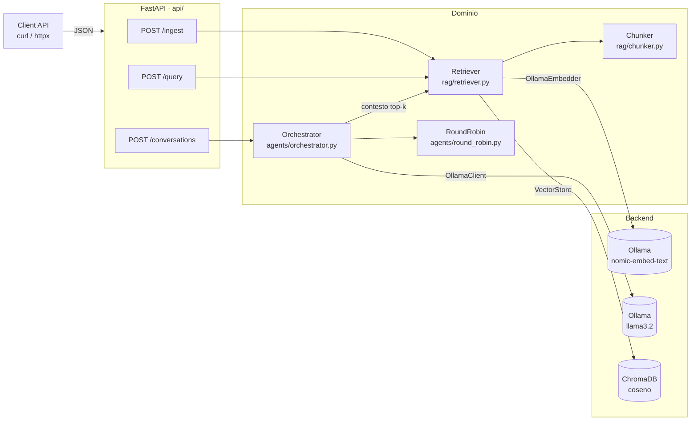

# Enterprise AI Orchestrator

> Un servizio GenAI che gira in locale: Retrieval-Augmented Generation su ChromaDB e
> conversazioni multi-agente round-robin su Ollama, dietro un'API FastAPI validata.
> Sviluppato test-first e distribuito come immagine Docker multi-stage.

🇬🇧 [Read in English](README_EN.md) · 🗺️ [Mappa interattiva dei flussi di dati](docs/data-flow/data-flow.html)


---

## Indice

- [Panoramica](#panoramica)
- [Architettura](#architettura)
- [Scelte progettuali](#scelte-progettuali)
- [Struttura del repository](#struttura-del-repository)
- [Installazione](#installazione)
- [Test](#test)
- [Esecuzione con Docker](#esecuzione-con-docker)
- [API ed esempi](#api-ed-esempi)
- [Configurazione](#configurazione)
- [Limiti noti e roadmap](#limiti-noti-e-roadmap)
- [Sviluppi Futuri (Roadmap MLOps)](#sviluppi-futuri-roadmap-mlops)

---

## Panoramica

L'Enterprise AI Orchestrator espone tre funzionalità via HTTP:

| Funzionalità | Endpoint | Cosa fa |
|---|---|---|
| **Ingestione della conoscenza** | `POST /ingest` | Divide un documento in chunk sovrapposti, ne calcola gli embedding con Ollama e li salva in ChromaDB |
| **Ricerca ibrida** | `POST /query` | Ordina i chunk sia per similarità vettoriale (ChromaDB) sia per corrispondenza di parole chiave BM25, fondendo le due classifiche con Reciprocal Rank Fusion |
| **Ragionamento multi-agente** | `POST /conversations` | Fa lavorare più agenti LLM in ordine round-robin rigoroso su un task condiviso; a ogni turno può aggiungere contesto RAG |

### Obiettivi

- **Tutto in locale.** I modelli girano su Ollama: nessun dato lascia la macchina e non c'è un costo per token.
- **Ogni confine è validato.** I modelli Pydantic v2 sono strict, immutabili e rifiutano i campi sconosciuti. Vengono validati i payload HTTP, le risposte dell'LLM, gli embedding e i risultati del vector store.
- **Testabile senza GPU né modello.** LLM ed embedder stanno dietro piccoli `Protocol`, quindi tutta la suite unitaria gira in pochi secondi con fake deterministici. I test contro un Ollama reale sono un livello separato e facoltativo.
- **Distribuito come artefatto riproducibile.** Un'immagine Docker multi-stage che gira come utente non-root, con health check, più uno stack Compose che scarica i modelli al primo avvio.
- **Disciplina di sviluppo.** Ogni modulo è nato in TDD: prima un test che fallisce, poi l'implementazione.

---

## Architettura



Per una versione più ricca e interattiva, con la spiegazione di ogni flusso, apri la
**[mappa dei flussi di dati](docs/data-flow/data-flow.html)** nel browser (tema chiaro/scuro, export SVG/PNG). La mappa è in inglese.

### Componenti

| Modulo | Tipi principali | Responsabilità |
|---|---|---|
| `config.py` | `Settings` | Configurazione tipizzata da variabili d'ambiente (`OLLAMA_HOST` validato come `HttpUrl`) |
| `api/app.py` | `create_app()` | Factory dell'app; all'avvio verifica il modello di embedding dello store; trasforma i guasti di Ollama in **503/504** generici |
| `api/routes.py` | `/health`, `/ingest`, `/query`, `/conversations` | Strato HTTP sottile, senza logica di business |
| `api/schemas.py` | `QueryRequest`, `ConversationRequest`, … | Contratti di richiesta e risposta con limiti (`k ≤ 50`, `max_turns ≤ 20`, nomi degli agenti univoci) |
| `api/dependencies.py` | `get_llm`, `get_retriever`, `get_settings` | Singleton creati alla prima richiesta; nei test si sostituiscono con `dependency_overrides` |
| `agents/schemas.py` | `Message`, `AgentSpec`, `Turn`, `Conversation` | Modello di dominio della conversazione |
| `agents/round_robin.py` | `RoundRobin` | Scheduler puro: ordine ciclico fisso, rifiuta liste vuote o con duplicati |
| `agents/orchestrator.py` | `Orchestrator` | Loop dei turni: sceglie l'agente, costruisce il prompt, aggiunge il contesto RAG, chiama l'LLM, si ferma a `max_turns` o allo `stop_token` |
| `models/llm.py` | `LLMClient` (Protocol), `OllamaClient` | `generate(list[Message], response_format=None) -> Message`; con un modello Pydantic la risposta è JSON valido rispetto al modello |
| `models/embeddings.py` | `Embedder` (Protocol), `OllamaEmbedder`, `Embedding` | Da testo a vettore di dimensione fissa e valori finiti (dimensione controllata da Pydantic) |
| `rag/schemas.py` | `Document`, `Chunk`, `RetrievalResult` | Modello di dominio RAG; score vincolato a `[0, 1]` |
| `rag/chunker.py` | `Chunker` | Finestre di caratteri con sovrapposizione; verifica che `overlap < size` |
| `rag/store.py` | `VectorStore` | Wrapper di ChromaDB (in memoria o persistente) che contiene solo i chunk: spazio coseno, upsert idempotente, `all_chunks()` per l'indice BM25 |
| `rag/metadata_db.py` | `MetadataDB` | SQLite (`sqlite3` della libreria standard): tabella dei puntatori `document_versions` e modello di embedding registrato, in `CHROMA_PATH/system.db` |
| `rag/retriever.py` | `Retriever` | `ingest(Document)` versionato con lock per documento, e `retrieve(query, k)` ibrido (vettoriale + BM25, RRF) solo sulle versioni attive |

### Come funziona una conversazione

1. `RoundRobin` sceglie il prossimo agente. La rotazione riparte da capo a ogni esecuzione, quindi i risultati sono riproducibili.
2. Se il RAG è attivo, il `Retriever` cerca con il task al primo turno e poi con l'ultima risposta, così il contesto segue la discussione.
3. L'agente di turno riceve:
   - il proprio system prompt (più, se c'è contesto RAG, una regola fissa: i documenti recuperati sono dati non fidati);
   - i chunk recuperati, numerati, in un messaggio `user` separato tra `<documents>…</documents>`;
   - il task;
   - i propri turni precedenti come messaggi `assistant`;
   - i turni degli altri agenti come messaggi `user`, preceduti dal nome (`[nome-agente]`).
4. La risposta viene validata come `Message` e aggiunta come `Turn`.
5. Il loop termina a `max_turns` oppure appena una risposta contiene lo `stop_token`. Il campo `stop_reason` indica quale dei due è successo.

---

## Scelte progettuali

| Scelta | Perché |
|---|---|
| **`Protocol` per `LLMClient` ed `Embedder`** | Il dominio non importa mai tipi di un SDK specifico. Sostituire Ollama con un altro provider significa aggiungere una classe, non rifattorizzare. I fake non richiedono librerie di mocking. |
| **Modelli Pydantic strict, frozen, `extra="forbid"`** | Un errore di battitura nel payload fallisce subito con un 422 e gli oggetti non si possono modificare dopo la validazione. |
| **L'output dell'LLM viene rivalidato** | Una risposta vuota o con un ruolo inatteso solleva una `ValidationError` invece di corrompere in silenzio la conversazione. |
| **Ingestion versionata** | Ogni ingestione è una versione: un hash di testo, metadati, chunking e modello di embedding, quindi gli id dei chunk sono `{doc}:{versione}:{i}`. La nuova versione viene scritta per intero in Chroma, poi il puntatore del documento viene spostato in una sola transazione SQLite (`INSERT OR REPLACE` in `document_versions` dentro `system.db`, accanto ai file di Chroma), infine si cancellano i chunk precedenti. Chi legge vede la versione vecchia o la nuova, mai un misto. Un errore prima dello spostamento lascia attiva la versione vecchia; i resti sono invisibili e vengono puliti alla successiva ingestione. Reingerire contenuto identico non fa nulla. Un lock per documento serializza le ingestioni concorrenti dello stesso id. Chroma contiene solo i chunk: con i puntatori in una seconda collection Chroma, chromadb 1.5.9 perdeva in modo permanente circa l'1–2% dei vettori quando le scritture su entrambe le collection erano seguite da una lettura; con una sola collection, 2.000 sequenze di stress non hanno perso nulla. |
| **Modello di embedding legato allo store** | Lo store registra modello e dimensione degli embedding al primo uso; all'avvio un modello o una dimensione diversi bloccano l'app (`EmbeddingMismatchError`) invece di mescolare spazi vettoriali. |
| **Il contesto RAG non è fidato** | I chunk recuperati non entrano mai nel system prompt. Viaggiano in un messaggio `user` separato tra tag `<documents>` (i tag presenti nei chunk vengono rimossi), e il system prompt dice al modello di non seguire istruzioni trovate lì. |
| **Lavoro limitato per richiesta** | `Document` limita il testo a 50.000 caratteri, l'id a 256, i metadati a 16 voci con chiavi ≤ 64 e valori testuali ≤ 256 caratteri. I payload troppo grandi ricevono 422 prima di qualsiasi embedding. I client Ollama hanno un timeout di 60 s, così un backend bloccato non occupa un thread per sempre. |
| **Ricerca ibrida con RRF** | Gli embedding non colgono identificatori esatti (codici d'errore, SKU) che BM25 trova, e viceversa. Ogni ricerca contribuisce con i suoi primi `4·k` risultati; lo score di un chunk è `Σ 1/(60 + rank)` sulle due classifiche, quindi non serve normalizzare score di metodi diversi. Un chunk primo in entrambe vale `2/61 ≈ 0,033`. |
| **Structured outputs** | `generate(..., response_format=Model)` passa a Ollama lo JSON Schema del modello (`format=`) e valida la risposta, perché lo schema guida soltanto la generazione. |
| **Logging strutturato** | Loguru scrive su stderr un oggetto JSON per riga. Ogni conversazione gira dentro `logger.contextualize(conversation_id=...)`, quindi anche i log di retrieval e LLM di quella sessione portano l'id. Il testo del task e delle risposte non viene mai loggato. |
| **503/504 generici sui guasti del backend** | Ollama irraggiungibile o in errore (per esempio modello non scaricato) dà **503**, un timeout dà **504**. Le risposte hanno un messaggio fisso; il testo dell'eccezione, che può contenere host o nomi di modelli, arriva solo nei log come tipo di eccezione. La telemetria di ChromaDB è disattivata. |
| **Limiti rigidi sui fattori di costo** | `max_turns ≤ 20` (ogni turno è una chiamata all'LLM), `k ≤ 50`, query ≤ 1.000 caratteri, task ≤ 4.000, al massimo 8 agenti, nome agente ≤ 64, system prompt ≤ 4.000, `stop_token` ≤ 64: tutti imposti a livello di API. Il body grezzo della richiesta è limitato a 1 MB da un middleware ASGI **prima** del parsing (413), così i limiti sui campi limitano anche la memoria. |
| **Superficie ridotta** | `TrustedHostMiddleware` risponde solo agli host in `ALLOWED_HOSTS` (default `localhost`, `127.0.0.1`, `orchestrator`), bloccando le pagine di DNS rebinding; `/docs`, `/redoc` e `/openapi.json` sono disattivati con `ENV=production`; compose pubblica l'API solo su `127.0.0.1`. |
| **Dipendenze create alla prima richiesta** | Importare l'app non apre connessioni né crea cartelle, quindi test e strumenti non hanno effetti collaterali. |

---

## Struttura del repository

```text
.
├── src/orchestrator/
│   ├── config.py
│   ├── api/          # factory dell'app, route, schemi di richiesta/risposta, DI
│   ├── agents/       # Message/AgentSpec/Turn/Conversation, RoundRobin, Orchestrator
│   ├── models/       # LLMClient + OllamaClient, Embedder + OllamaEmbedder
│   └── rag/          # Document/Chunk/RetrievalResult, Chunker, VectorStore, Retriever
├── tests/
│   ├── fakes.py      # ScriptedLLM, FakeRetriever, KeywordEmbedder (fake deterministici)
│   ├── conftest.py   # fixture condivise: embedder, store in memoria, llm
│   ├── api/  agents/  models/  rag/
│   └── models/test_ollama_integration.py   # @pytest.mark.integration
├── docs/data-flow/   # mappa interattiva dei flussi (HTML) e il suo sorgente
├── Dockerfile        # multi-stage, non-root, HEALTHCHECK
├── docker-compose.yml
├── Makefile
├── requirements.txt / requirements-dev.txt
└── pyproject.toml    # configurazione e marker di pytest
```

---

## Installazione

### Prerequisiti

- Python **3.12**
- [Ollama](https://ollama.com) in esecuzione in locale (serve solo per l'inferenza reale e i test di integrazione)
- Docker con Compose v2 (facoltativo)

### Installazione locale

```bash
python -m venv .venv
# Windows: .venv\Scripts\activate    macOS/Linux: source .venv/bin/activate
pip install -r requirements.txt -r requirements-dev.txt
```

### Scaricare i modelli

```bash
ollama pull llama3.2
ollama pull nomic-embed-text
```

### Avviare l'API

```bash
make run
# oppure, senza make:
python -m uvicorn orchestrator.api.app:app --app-dir src --reload
```

La documentazione OpenAPI interattiva è su <http://localhost:8000/docs> (solo in sviluppo: è disattivata con `ENV=production`, il default di compose).

> **Nota per Windows:** `make` non è installato di default (`choco install make`). Ogni target del
> `Makefile` è un solo comando che puoi anche lanciare a mano.

---

## Test

La suite ha due livelli, separati da un marker di pytest registrato in `pyproject.toml` (`--strict-markers` è attivo).

| Livello | Comando | Serve | Durata |
|---|---|---|---|
| Unità e API | `pytest -m "not integration"` | niente di esterno | circa 1-5 s |
| Integrazione | `pytest -m integration` | Ollama con `llama3.2` e `nomic-embed-text` | decine di secondi |
| Tutto | `pytest` (o `make test`) | — | — |

- I test unitari usano i fake deterministici di `tests/fakes.py` e un **ChromaDB in memoria** (`EphemeralClient`, con una collection dal nome univoco per ogni test).
- I test dell'API usano l'app FastAPI vera tramite `TestClient` e sostituiscono solo LLM e retriever con `app.dependency_overrides`.
- I test di integrazione **si saltano da soli**, spiegando il motivo, se Ollama non è raggiungibile o manca un modello. Così la CI senza server di modelli resta verde.

```bash
pytest -m integration -rs   # -rs mostra il motivo dei test saltati
```

---

## Esecuzione con Docker

### Stack completo (consigliato)

```bash
make docker-up      # docker compose up -d --build
make docker-down    # docker compose down
```

| Servizio | Immagine | Ruolo |
|---|---|---|
| `ollama` | `ollama/ollama` | Server dei modelli, con health check `ollama list`; i modelli restano nel volume `ollama-models` |
| `ollama-init` | `ollama/ollama` | Job una tantum: scarica `${MODEL_NAME:-llama3.2}` e `nomic-embed-text`, poi termina |
| `orchestrator` | costruita dal `Dockerfile` | L'API su `127.0.0.1:8000` (solo loopback), con `ENV=production`; parte solo dopo che `ollama-init` è terminato con successo; ChromaDB resta nel volume `chroma-data` montato su `/data/chroma` |

Il primo avvio scarica i modelli (circa 2,3 GB) nel volume; quelli successivi li riusano.
Per usare una GPU NVIDIA, togli il commento al blocco `deploy` del servizio `ollama` (richiede `nvidia-container-toolkit`).

### Solo l'immagine

```bash
make docker-build   # docker build -t enterprise-ai-orchestrator .
make docker-run     # docker run --rm -p 127.0.0.1:8000:8000 enterprise-ai-orchestrator
```

L'immagine viene costruita in due stadi:

- **Builder:** un virtualenv con le dipendenze installate.
- **Runtime:** `python:3.12-slim` con solo il virtualenv e `src/`. Gira come utente `app` (uid 1000) e ha un `HEALTHCHECK` su `/health` scritto con la sola libreria standard.

---

## API ed esempi

Le risposte qui sotto vengono da un'esecuzione locale reale contro Ollama (`llama3.2`, `nomic-embed-text`).

### `GET /health`

```bash
curl http://localhost:8000/health
```
```json
{"status": "ok", "version": "0.1.0"}
```

### `POST /ingest` → `201 Created`

```bash
curl -X POST http://localhost:8000/ingest \
  -H "Content-Type: application/json" \
  -d '{
        "id": "caching-guide",
        "text": "Redis supports per-key TTL expiration. An LRU policy evicts the least recently used keys when memory is full. Write-through caching updates the cache and the database in the same request.",
        "metadata": {"source": "caching.md"}
      }'
```
```json
{"document_id": "caching-guide", "chunks": 1}
```

Ingerire di nuovo lo stesso `id` pubblica una nuova versione che, per chi legge, sostituisce la precedente in modo atomico; un contenuto identico non fa nulla. `text` deve contenere caratteri diversi dagli spazi. I valori di `metadata` devono essere semplici (testo, numero o booleano) e le chiavi che iniziano con `$`, `#` o `chroma:` sono riservate a ChromaDB e vengono rifiutate. Limiti: `text` ≤ 50.000 caratteri, `id` ≤ 256, al massimo 16 voci di metadati, chiavi ≤ 64 e valori testuali ≤ 256 caratteri; oltre si riceve 422.

### `POST /query`

```bash
curl -X POST http://localhost:8000/query \
  -H "Content-Type: application/json" \
  -d '{"query": "How are old keys evicted?", "k": 2}'
```
```json
{
  "results": [
    {
      "chunk": {
        "id": "caching-guide:5f0c2a9e41d7b3c8:0",
        "document_id": "caching-guide",
        "index": 0,
        "text": "Redis supports per-key TTL expiration. An LRU policy evicts ...",
        "metadata": {"source": "caching.md"}
      },
      "score": 0.0328
    }
  ]
}
```

### `POST /conversations`

```bash
curl -X POST http://localhost:8000/conversations \
  -H "Content-Type: application/json" \
  -d '{
        "task": "Propose a caching strategy for a product catalog API. Answer in at most 2 sentences.",
        "agents": [
          {"name": "architect", "system_prompt": "You are a pragmatic software architect. Be concise."},
          {"name": "reviewer",  "system_prompt": "You review designs and point out one risk. Say APPROVED when satisfied."}
        ],
        "max_turns": 4,
        "stop_token": "APPROVED",
        "use_rag": true,
        "k": 2
      }'
```
```json
{
  "task": "Propose a caching strategy for a product catalog API. Answer in at most 2 sentences.",
  "turns": [
    {"agent": "architect", "message": {"role": "assistant", "content": "Implement a hybrid caching strategy using Redis with a TTL ..."}},
    {"agent": "reviewer",  "message": {"role": "assistant", "content": "... APPROVED"}}
  ],
  "stop_reason": "stop_token"
}
```

| Campo | Default | Vincolo |
|---|---|---|
| `task` | — | non vuoto |
| `agents` | — | almeno 1, `name` univoci, nessun campo extra |
| `max_turns` | `6` | da 1 a 20 |
| `stop_token` | `null` | non vuoto se presente |
| `use_rag` | `true` | — |
| `k` | `4` | da 1 a 50 |

### Client Python

```python
import httpx

with httpx.Client(base_url="http://localhost:8000", timeout=120) as api:
    api.post("/ingest", json={"id": "faq", "text": "I rimborsi vengono elaborati entro 5 giorni lavorativi."}).raise_for_status()

    hits = api.post("/query", json={"query": "Quanto tempo richiede un rimborso?", "k": 3}).json()["results"]
    for hit in hits:
        print(f"{hit['score']:.2f}  {hit['chunk']['text']}")

    conv = api.post("/conversations", json={
        "task": "Scrivi una risposta a un cliente che chiede i tempi di rimborso.",
        "agents": [
            {"name": "writer", "system_prompt": "Scrivi risposte di assistenza cordiali."},
            {"name": "editor", "system_prompt": "Rendi il testo più conciso. Scrivi DONE quando la risposta è definitiva."},
        ],
        "max_turns": 4,
        "stop_token": "DONE",
    }).json()
    for turn in conv["turns"]:
        print(f"[{turn['agent']}] {turn['message']['content']}")
```

### Codici di risposta

| Stato | Quando |
|---|---|
| `201` | Documento ingerito |
| `400` | Header `Host` non presente in `ALLOWED_HOSTS` |
| `413` | Body della richiesta oltre 1 MB |
| `422` | Errore di validazione: query o task vuoti o troppo lunghi, troppi agenti, `k`/`max_turns` fuori intervallo, nomi di agenti duplicati, campi sconosciuti, metadata non semplici |
| `503` | Ollama non raggiungibile (`{"detail": "model backend unavailable"}`) o in errore, per esempio modello mancante (`"model backend error"`); la richiesta si può ritentare |
| `504` | Timeout di Ollama (`{"detail": "model backend timed out"}`); la richiesta si può ritentare |

---

## Configurazione

| Variabile | Default | Usata da |
|---|---|---|
| `OLLAMA_HOST` | `http://localhost:11434` | Client LLM ed embedding (deve essere un URL `http(s)` valido) |
| `CHROMA_PATH` | `chroma_db` | Cartella persistente di ChromaDB |
| `MODEL_NAME` | `llama3.2` | Modello di chat usato dagli agenti |
| `ALLOWED_HOSTS` | `localhost,127.0.0.1,orchestrator` | Valori di `Host` accettati, separati da virgola |
| `ENV` | `development` | `production` disattiva `/docs`, `/redoc` e `/openapi.json` (lo imposta compose) |

Il modello di embedding è `nomic-embed-text` (768 dimensioni), il default di `OllamaEmbedder`.

---

## Limiti noti e roadmap

Questi limiti sono elencati di proposito: sono le prossime iterazioni, non debito nascosto.

- **L'indice BM25 viene ricostruito da ChromaDB a ogni query.** È sempre coerente con ingestioni concorrenti e altri processi, ma costa O(corpus) per query; per corpus grandi va messo in cache per versione dello store.
- **Una richiesta di embedding per chunk.** L'API `embed` di Ollama accetta più testi insieme; raggrupparli velocizzerebbe le ingestioni grandi.
- **Nessuna autenticazione né rate limiting.** Compose espone l'API solo su `127.0.0.1`; per esporla oltre, mettila dietro un gateway con autenticazione.
- **Aggiornamento da uno store creato prima di `system.db`:** i puntatori di versione stavano in una collection Chroma `<collection>__system`, che non viene più letta. Reingerisci quei documenti; l'ingestione rimuove anche i loro chunk precedenti.
- **I lock di ingestione valgono per singolo processo.** Usa un solo processo API per store, oppure aggiungi un lock condiviso, prima di scalare i worker.
- **Aggiornamento da uno store precedente al versionamento:** i chunk scritti prima non hanno una versione attiva e non vengono restituiti. Reingerisci quei documenti; i vecchi chunk vengono rimossi durante quell'ingestione.
- **Chiamate all'LLM sincrone.** Le conversazioni lunghe occupano un thread; streaming e client async sono il passo successivo naturale.
- **`ollama/ollama:latest` non è fissato a una versione.** Per deploy riproducibili va fissata.
- **Modello e dimensione degli embedding non sono ancora configurabili** tramite variabili d'ambiente.

## Sviluppi Futuri (Roadmap MLOps)

Le prossime iterazioni portano il progetto verso un sistema LLMOps riproducibile e osservabile, mantenendo lo stack attuale. Il punto di partenza è un audit del codice così com'è oggi, eseguito il 30/10/2026. Piano completo, vincoli e criteri di accettazione: **[docs/MLOPS_ROADMAP_IT.md](docs/MLOPS_ROADMAP_IT.md)**.

| Fase | Tema | Risultato |
|---|---|---|
| 1 | **Valutazione del RAG** | Benchmark versionato; Recall@k, MRR, nDCG@k per ricerca vettoriale, BM25 e ibrida; soglie di regressione |
| 2 | **Versionamento dell'ingestion** | Id per documento, versione e chunk; attivazione sicura delle nuove versioni; aggiornamenti concorrenti o falliti gestiti |
| 3 | **CI/CD** | GitHub Actions: lint, mypy, test, scansione delle vulnerabilità, build Docker e health check a ogni PR |
| 4 | **Experiment tracking** | Ogni esecuzione ricostruibile da commit, modelli, dataset e parametri (MLflow o manifest JSON versionati) |
| 5 | **Observability** | Metriche per endpoint, latenze, errori di Ollama, health check separati per liveness e readiness |
| 6 | **Security hardening** | Autenticazione, rate limiting, difese da prompt injection, gestione di segreti e dati |
| 7 | **Deployment controllato** | Immagini versionate, smoke test, rilascio documentato, rollback, backup e ripristino |

Stato: la Fase 2 (versionamento dell'ingestion) è **implementata**, con lock solo nel singolo processo. La Fase 6 è **parziale**: mappatura degli errori, limiti di input, isolamento da prompt injection e telemetria di ChromaDB sono fatti; autenticazione e rate limiting no. Le altre fasi sono **pianificate**.

---

<sub>Sviluppato test-first: ogni modulo è partito da un test che falliva. Vedi <code>tests/</code>.</sub>
